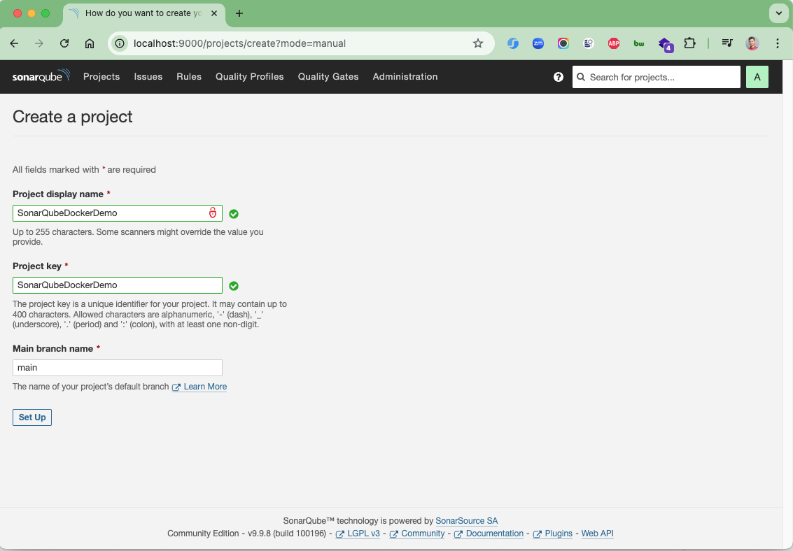
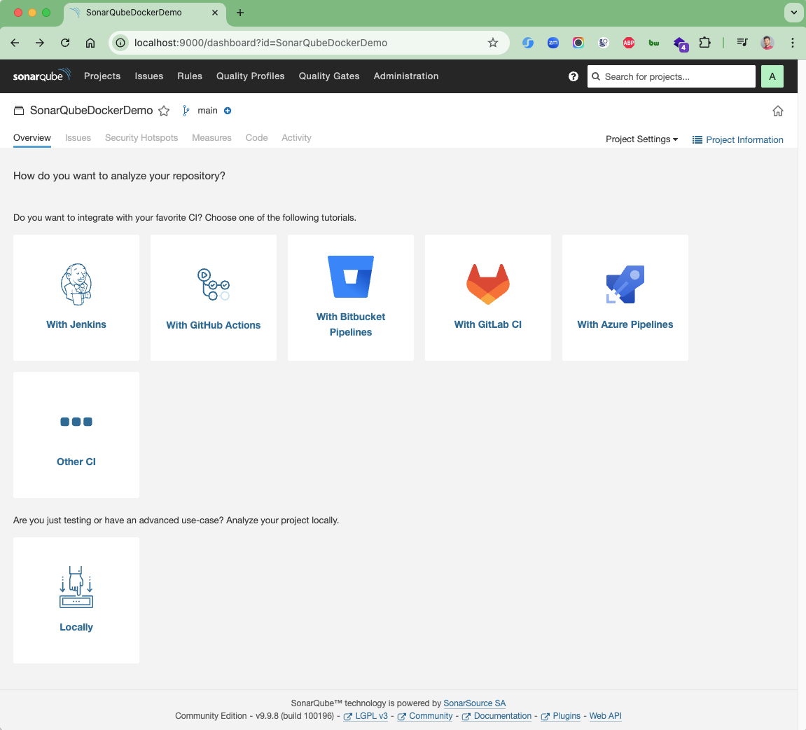
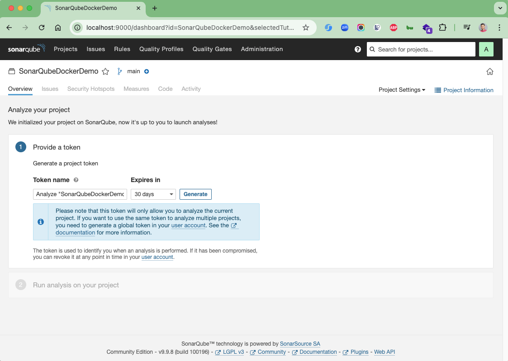
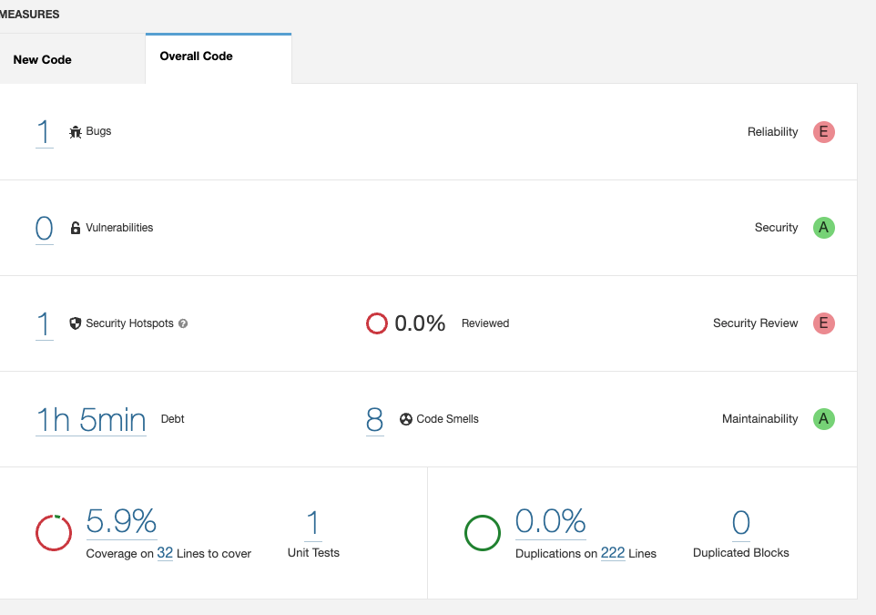

# spring-boot-sonarqube-demo

[](https://github.com/hendisantika/spring-boot-sonarqube-demo/actions/workflows/maven.yml)


Demo project showing how to analyze a Spring Boot application with SonarQube. The code intentionally contains
bugs, vulnerabilities, security hotspots and duplications (see `BugExample`, `VulnerabilityExample`,
`HotSpotExample` and `DuplicationExample`) so you can see them reported in SonarQube.

### Requirements

- JDK 25
- Docker & Docker Compose (SonarQube + PostgreSQL are started from `compose.yaml`)
- Maven 3.9+ (or use the bundled Maven wrapper `./mvnw`)

### Things todo list:

1. Clone this repository: `git clone https://github.com/hendisantika/spring-boot-sonarqube-demo.git`
2. Navigate to the folder: `cd spring-boot-sonarqube-demo`
3. Run the application: `./mvnw clean spring-boot:run`
   (Spring Boot Docker Compose support starts SonarQube and PostgreSQL automatically; alternatively run
   `docker compose up -d`)
4. Open your favorite browser: http://localhost:9000
5. Login with default username & password: `admin/admin`
6. Create a new project
7. Generate a token
8. Run the sonar-scanner
    ```
   ./mvnw clean verify sonar:sonar \
    -Dsonar.projectKey=SonarQubeDockerDemo \
    -Dsonar.host.url=http://localhost:9000 \
    -Dsonar.token=<YOUR_SONAR_TOKEN>
    ```
   Optionally add `-PsonarReports` to also generate an OWASP Dependency-Check report for SonarQube.
9. Check the result
10. Done

### Continuous Integration

GitHub Actions (`.github/workflows/maven.yml`) builds and tests the project with Temurin JDK 25 on every push and
pull request to `main`, and submits the Maven dependency graph to GitHub on pushes to `main`.

### Dependency Updates

Dependabot (`.github/dependabot.yml`) checks Maven dependencies and GitHub Actions daily at 05:00 (Asia/Jakarta).
Updates are grouped (Spring Boot, Maven plugins, minor/patch, GitHub Actions), labeled, and use conventional
commit prefixes (`build(deps)`, `build(deps-dev)`, `ci(deps)`).

### Images Screen shot

Create a new project



Choose Local



Generate a token



Check the result


